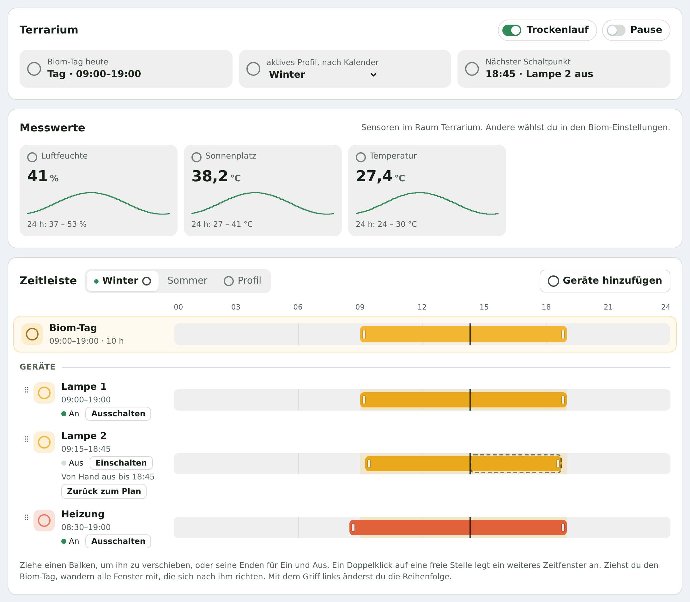

# Cloudless Biome

Eine Home-Assistant-Integration, die Terrarien, Gewächshäuser und andere Biome nach der Uhr steuert. Statt einzelner Zeitpläne pro Steckdose gibt es einen gemeinsamen Biom-Tag: Er beginnt und endet zu festen Zeiten, und jedes Gerät schaltet mit seinem eigenen Versatz dazu. Lampe 2 geht dann zum Beispiel 15 Minuten nach Lampe 1 an und 15 Minuten vor ihr aus. Für jede Jahreszeit gibt es ein eigenes Profil.

[English version](README.md)



> **Beta.** Zeitsteuerung, Intervalle, natürlicher Tag, Messwerte und Energie sind drin. Eine Regelung nach Sensoren folgt.

> **Sicherheit.** Biome ersetzt keinen Thermostat. Fällt Home Assistant aus, bleiben die Geräte im letzten Zustand. Heizungen gehören deshalb zusätzlich an einen Thermostat mit eigener Abschaltung.

## Was du bekommst

- **Biom-Tag mit Versatz.** Tagesbeginn und Tagesende gelten für das ganze Biom. Jedes Gerät schaltet relativ dazu, positive Minuten heißen später, negative früher. Ein Tag darf auch über Mitternacht gehen.
- **Profile für Jahreszeiten.** Jedes Profil hat einen eigenen Biom-Tag und legt fest, welche Geräte laufen, im Sommer etwa ohne Zusatzheizung. Ein Profil beginnt an einem Datum, mit der Zeitumstellung oder zum astronomischen Jahreszeitbeginn, auf Wunsch einige Tage davor oder danach und mit einem weichen Übergang über mehrere Tage. Ein von Hand gewähltes Profil gilt sofort und bis zum nächsten Wechsel.
- **Natürlicher Tag.** Statt fester Zeiten folgt der Biom-Tag der Sonne, am eigenen Standort oder an einem anderen Ort, mit kürzestem und längstem Tag und auf Wunsch um den Sonnenhöchststand gelegt.
- **Verlässlich.** Biome schaltet minutengenau zu jedem Schaltpunkt und prüft zusätzlich alle 10 Minuten, ob die Geräte tun, was der Plan will. Weicht etwas ab, schaltet Biome nach, auch nach einem Neustart oder wenn ein Gerät wieder erreichbar wird. Folgt ein Gerät nicht, meldet ein Problem-Sensor das.
- **Handschaltung.** Schaltet jemand ein Gerät von Hand, einstellbar pro Gerät: bis zum nächsten Schaltpunkt (Standard), für eine feste Dauer oder sofort zurück zum Plan.
- **Trockenlauf.** Ein neues Biom schaltet zunächst nichts, sondern protokolliert nur, was es schalten würde. So prüfst du den Plan neben den bisherigen Zeitplänen der Geräte.
- **Zeitfenster und Intervalle.** Pro Gerät und Profil mehrere Zeitfenster, jedes Ende ab Tagesbeginn, ab Tagesende oder zu einer Uhrzeit, oder durchgehend an, etwa für eine Heizmatte. Ein Fenster kann ein Intervall haben, z. B. alle 15 Minuten für 60 Sekunden.
- **Maximale Einschaltdauer.** Je Art und je Gerät, z. B. 30 Sekunden für Beregnung (auch Nebler). Bleibt ein Gerät länger an, schaltet Biome es ab, auch nach einer Handschaltung.
- **Messwerte und Energie.** Sensoren mit ihrem Verlauf der letzten 24 Stunden sowie Leistung und Verbrauch der Geräte, auf Wunsch mit Kosten.
- **Notizen.** Ein Textfeld pro Biom, zum Beispiel für die Ansprüche deiner Tiere oder Pflanzen.
- **Pause.** Biome schaltet nichts, die Geräte bleiben, wie sie sind.
- **Dimmen.** Dimmbare Leuchten bekommen pro Profil eine Helligkeit und auf Wunsch ein langsames Hoch- und Runterdimmen.
- **Eine Seite in der Seitenleiste** mit einer Zeitleiste zum Ziehen, dem Zustand jedes Geräts, einem Knopf zum direkten Schalten und einem Protokoll, in dem Intervall-Schaltungen eingeklappt sind und sich bei Bedarf einblenden lassen. Ohne YAML, auf Deutsch und Englisch.

## Installieren

**Home Assistant 2026.11 oder neuer (Marketplace)**

[](https://my.home-assistant.io/redirect/hacs_repository/?owner=MadisonMedia&repository=cloudless-biome&category=integration)

1. Wähle den Button oben, oder gehe zu **Einstellungen → Marketplace** und füge `https://github.com/MadisonMedia/cloudless-biome` per Link hinzu.
2. Solange Biome im Beta-Stadium ist, schalte beim Repository den Schalter für Vorabversionen (Pre-release) ein und installiere es dann.

**Home Assistant 2026.10 oder älter (HACS)**

1. Öffne in HACS das Menü oben rechts und wähle **Benutzerdefinierte Repositories**.
2. Füge `https://github.com/MadisonMedia/cloudless-biome` mit dem Typ **Integration** hinzu.
3. Installiere **Cloudless Biome** und starte Home Assistant neu.

Benötigt Home Assistant 2026.2 oder neuer.

## Einrichten

[](https://my.home-assistant.io/redirect/config_flow_start/?domain=cloudless_biome)

1. **Biom anlegen:** **Einstellungen → Geräte & Dienste → Integration hinzufügen → Cloudless Biome**. Gib dem Biom einen Namen und lege den Biom-Tag des ersten Profils fest.
2. **Geräte hinzufügen:** Auf der Seite **Biome** in der Seitenleiste wählst du **Geräte hinzufügen** und hakst alle Steckdosen und Leuchten des Bioms auf einmal ab.
3. **Auf der Zeitleiste anordnen:** Ziehe einen Balken, um ihn zu verschieben, oder seine Enden, um Ein und Aus zu ändern. Die Zeiten rasten auf 5 Minuten ein. Ziehst du den Biom-Tag, wandern alle Geräte mit. Mit dem Griff links neben einem Gerät änderst du die Reihenfolge. Ein Klick auf ein Gerät öffnet Name, Art, das Verhalten bei Handschaltung und für das gewählte Profil, ob und wann es läuft: mit dem Biom-Tag, zu festen Uhrzeiten oder durchgehend. Mit **Speichern** übernimmst du alle Änderungen auf einmal.
4. **Profile:** Die Reiter über der Zeitleiste wählen das Profil, das du bearbeitest. Ein zweiter Klick auf den Reiter öffnet Name, Zeiten, Startdatum und Übergang, **+ Profil** legt ein neues an. Geräte, die du im neuen Profil noch nicht verschoben hast, laufen wie im Profil, von dem aus du es angelegt hast.
5. **Übernehmen:** Wenn der Plan im Trockenlauf stimmt, schalte den Trockenlauf aus. Zeitpläne, die direkt auf den Geräten laufen, sollten dann aus sein.

Profile und Geräte lassen sich auch über die Dialoge der Integration unter **Einstellungen → Geräte & Dienste** ändern. Bekommt ein Gerät nach neuem Koppeln eine andere Entität, wählst du in den Details einfach die neue aus. Die Einstellungen bleiben erhalten.

## So wird gerechnet

- Ein Gerät mit dem Biom-Tag ist an von *Tagesbeginn + Versatz Einschalten* bis *Tagesende + Versatz Ausschalten*. Liegt das Ende davor, bleibt es aus. Feste Uhrzeiten dürfen über Mitternacht gehen.
- Ist ein Gerät in einem Profil nicht aktiv, hält Biome es aus.
- Bei einem weichen Übergang über *n* Tage rücken Tagesbeginn und Tageslänge jeden Tag um ein (*n*+1)-tel näher an das neue Profil. Welche Geräte laufen, wechselt schon am Startdatum.
- Eine Änderung durch eine Person, eine App, einen Taster am Gerät oder eine Automation gilt als Handschaltung. Kommt ein Gerät aus „nicht erreichbar“ zurück oder weicht es ab, ohne dass Biome die Änderung gesehen hat, stellt Biome den Plan wieder her.
- Ohne Profil schaltet Biome nichts.

## Entitäten

Das Biom ist ein Gerät mit **Profil** (Auswahl), **Pause** und **Trockenlauf** (Schalter), **Phase** (Tag oder Nacht), **Nächster Schaltpunkt** und **Alle zurück zum Plan**. Jedes Biome-Gerät bekommt ein eigenes Gerät mit **Status** (an, aus, von Hand an oder aus, inaktiv), **Problem** und **Zurück zum Plan**.

## Entwicklung

```bash
pip install -r requirements_test.txt
pytest -q
ruff check .
ruff format --check .
```

`tests/frontend/harness.html` zeigt die echte Seite mit festen Daten aus dem Backend. Liefere das Hauptverzeichnis des Repositorys mit einem lokalen Webserver aus und öffne die Datei, mit `?lang=en`, `?dark=1` oder `?width=420`.

## Lizenz

MIT
