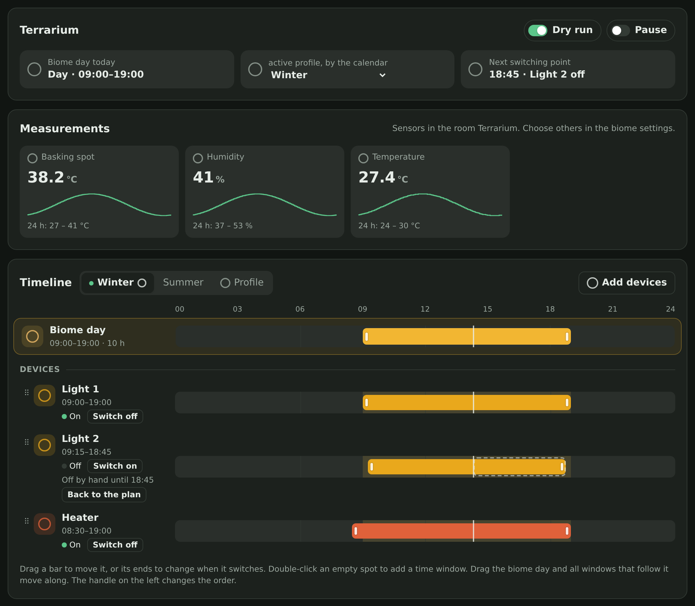

# Cloudless Biome

A Home Assistant integration that runs terrariums, greenhouses and other biomes by the clock. Instead of a schedule per outlet there is one biome day: it starts and ends at set times, and each device switches with its own offset. Lamp 2, for example, comes on 15 minutes after lamp 1 and goes off 15 minutes before it. Each season gets its own profile.

[Deutsche Version](README.de.md)



> **Beta.** Time control, intervals, the natural day, measurements and energy are in. Control by sensors comes next.

> **Safety.** Biome does not replace a thermostat. If Home Assistant fails, the devices stay as they are. Heaters therefore also belong on a thermostat with its own cut-off.

## What you get

- **A biome day with offsets.** The day's start and end apply to the whole biome. Each device switches relative to them; positive minutes mean later, negative earlier. A day may run past midnight.
- **Profiles for seasons.** Each profile has its own biome day and sets which devices run, in summer for example without the extra heater. A profile starts on a date, when the clocks change or at the astronomical start of a season, some days before or after if you like, and with a soft change over several days. A profile chosen by hand applies at once and lasts until the next change.
- **Natural day.** Instead of fixed times the biome day follows the sun, where you live or at another place, between a shortest and a longest day and, if you like, centred on the sun's highest point.
- **Reliable.** Biome switches on the minute at every switching point and also checks every 10 minutes that the devices do what the plan wants. Where they differ, it switches, also after a restart or when a device is reachable again. When a device does not follow, a problem sensor says so.
- **Switching by hand.** When someone switches a device by hand, per device: until the next switching point (default), for a fixed time, or back to the plan at once.
- **Dry run.** A new biome switches nothing at first; it only logs what it would switch. Check the plan next to the devices' own schedules.
- **Time windows and intervals.** Several time windows per device and profile, each end counted from the day's start, its end or a clock time, or around the clock, for example for a heat mat. A window can have an interval, for example every 15 minutes for 60 seconds.
- **Longest time on.** Per kind and per device, for example 30 seconds for rain (misters included). When a device stays on longer, Biome switches it off, even after a manual switch.
- **Measurements and energy.** Sensors with their last 24 hours, and the power and energy of the devices, with costs if you like.
- **Notes.** A text field per biome, for example for what your animals or plants need.
- **Pause.** Biome switches nothing; the devices stay as they are.
- **Dimming.** Dimmable lights get a brightness per profile and, if you like, slow dimming up and down.
- **A page in the sidebar** with a timeline you can drag, each device's state, a button to switch it directly, and a log in which interval switches are folded away until you ask for them. No YAML; English and German.

## Install

**Home Assistant 2026.11 or newer (Marketplace)**

[](https://my.home-assistant.io/redirect/hacs_repository/?owner=MadisonMedia&repository=cloudless-biome&category=integration)

1. Use the button above, or go to **Settings → Marketplace** and add `https://github.com/MadisonMedia/cloudless-biome` by link.
2. While Biome is in beta, turn on pre-releases for the repository, then install it.

**Home Assistant 2026.10 or older (HACS)**

1. In HACS, open the menu at the top right and choose **Custom repositories**.
2. Add `https://github.com/MadisonMedia/cloudless-biome` with the type **Integration**.
3. Install **Cloudless Biome** and restart Home Assistant.

Requires Home Assistant 2026.2 or newer.

## Set up

[](https://my.home-assistant.io/redirect/config_flow_start/?domain=cloudless_biome)

1. **Create a biome:** **Settings → Devices & services → Add integration → Cloudless Biome**. Name the biome and set the biome day of the first profile.
2. **Add devices:** On the **Biome** page in the sidebar choose **Add devices** and tick all outlets and lights of the biome at once.
3. **Arrange them on the timeline:** Drag a bar to move it, or its ends to change when it switches on and off. Times snap to 5 minutes. Drag the biome day and all devices move along. The handle to the left of a device changes the order. Click a device for its name, kind, what happens when it is switched by hand and, for the chosen profile, whether and when it runs: with the biome day, at fixed times or around the clock. **Save** applies all changes at once.
4. **Profiles:** The tabs above the timeline choose the profile you edit. Click the tab again for its name, times, start date and soft change; **+ Profile** adds one. Devices you have not moved in the new profile run as in the profile you created it from.
5. **Take over:** When the plan is right in the dry run, turn the dry run off. Schedules that run on the devices themselves should be off by then.

Profiles and devices can also be changed in the integration's dialogs under **Settings → Devices & services**. If a device gets a different entity after pairing again, just pick the new one in its details; the settings stay.

## How it works out

- A device with the biome day is on from *day start + offset on* to *day end + offset off*. If the end comes first, it stays off. Fixed times may run past midnight.
- A device that is not active in a profile is kept off.
- With a soft change over *n* days, the day's start and length move one (*n*+1)th closer to the new profile each day. Which devices run changes on the start date.
- A change by a person, an app, a button on the device or an automation counts as switching by hand. When a device comes back from unavailable, or differs without Biome having seen the change, Biome restores the plan.
- Without a profile, Biome switches nothing.

## Entities

The biome is a device with **Profile** (select), **Pause** and **Dry run** (switches), **Phase** (day or night), **Next switching point** and **All back to the plan**. Each Biome device gets a device of its own with **Status** (on, off, on or off by hand, inactive), **Problem** and **Back to the plan**.

## Development

```bash
pip install -r requirements_test.txt
pytest -q
ruff check .
ruff format --check .
```

`tests/frontend/harness.html` shows the real page with fixed data from the backend. Serve the repository root with any local web server and open the file, with `?lang=en`, `?dark=1` or `?width=420`.

## License

MIT
